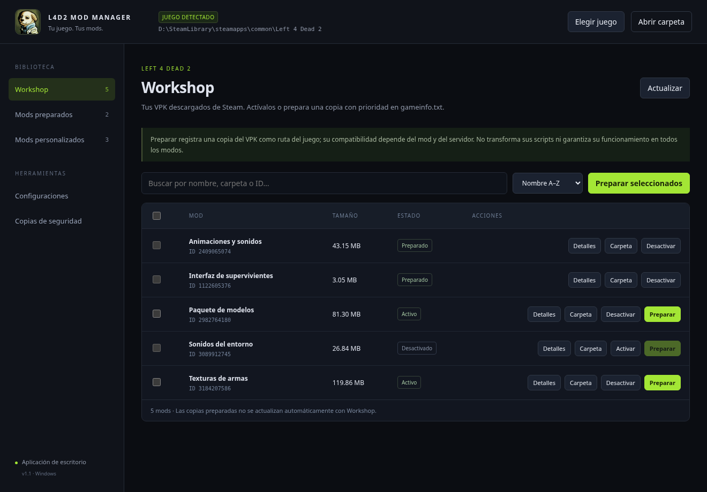
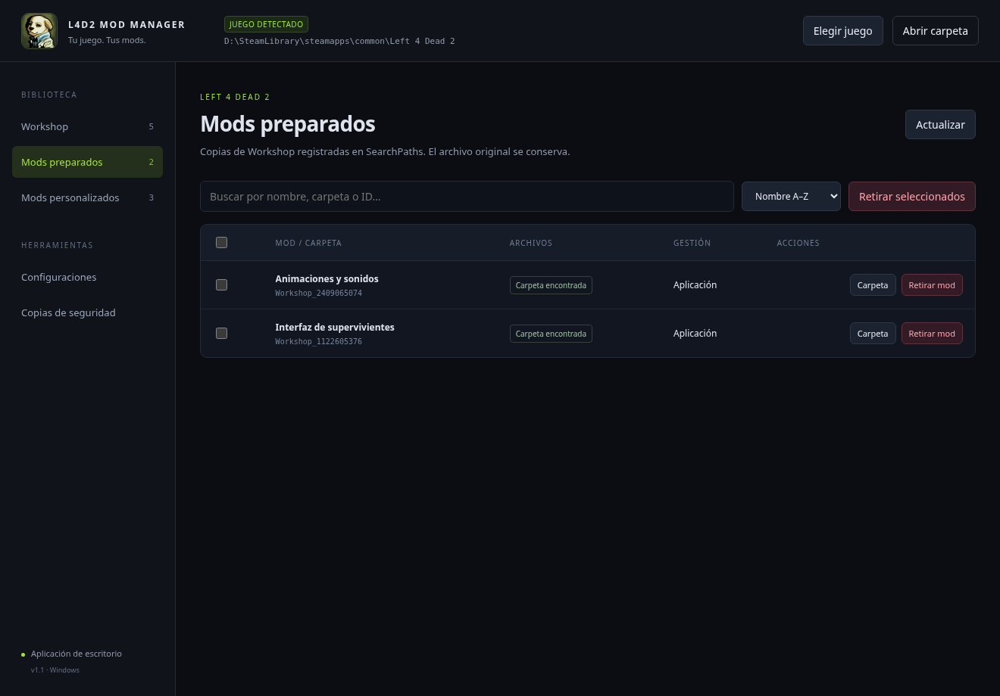
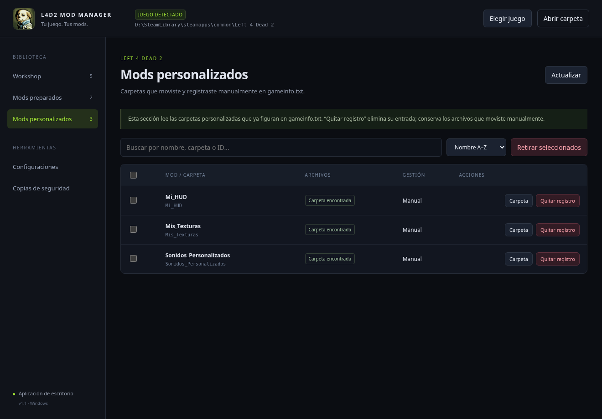
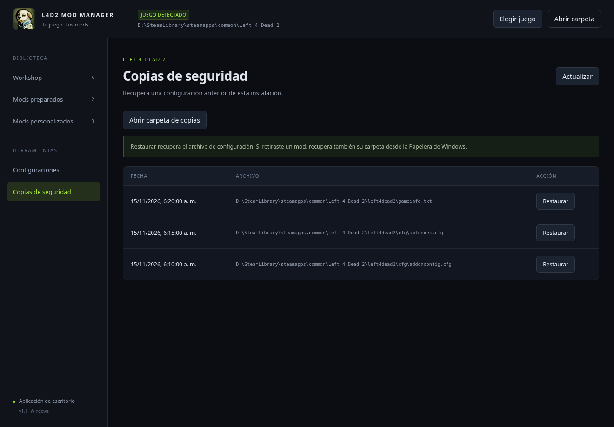

<p align="center">
  
</p>

<h1 align="center">L4D2 Mod Manager</h1>

<p align="center"><strong>Tus mods y configuraciones de Left 4 Dead 2, en una aplicación de escritorio.</strong></p>

Aplicación de escritorio para Windows que administra mods y configuraciones de **Left 4 Dead 2**. Electron abre la interfaz incluida en el proyecto directamente. No utiliza servidor local, navegador externo, Express, Vite ni React.

## Descargar para Windows

**[Descargar L4D2 Mod Manager v1.1.0 portable (.exe)](https://github.com/CodeByDante/manager-left-4-dead-2/releases/download/v1.1.0/L4D2-Mod-Manager-1.1.0-x64.exe)**

Windows de 64 bits · Abre el ejecutable directamente · No requiere Node.js.

[Ver la versión y sus archivos en Releases](https://github.com/CodeByDante/manager-left-4-dead-2/releases/tag/v1.1.0) · [Comprobación SHA-256](https://github.com/CodeByDante/manager-left-4-dead-2/releases/download/v1.1.0/SHA256SUMS.txt)



> Las imágenes muestran la interfaz real ejecutada con datos ilustrativos para explicar su uso. Los nombres, IDs, rutas y copias visibles son ejemplos; no son una prueba de compatibilidad de esos mods con el juego. La aplicación distribuida solo lista tus archivos reales.

## Guía visual de uso

### 1. Detectar la instalación

Al abrir la aplicación se busca Steam en el registro de Windows y se consultan sus bibliotecas. A partir de la instalación encontrada se resuelven las rutas de Workshop, `gameinfo.txt` y los archivos de `cfg`. No necesitas seleccionar cada ruta por separado.

Si usas otra instalación o no se detecta, pulsa **Elegir juego** y selecciona la carpeta raíz que contiene `left4dead2\gameinfo.txt`. La elección se conserva para las próximas sesiones. **Abrir carpeta** muestra esa ubicación en Windows.

### 2. Revisar y preparar mods del Workshop


1. Busca un mod por nombre o ID, o cambia el orden de la lista.
2. Abre **Detalles** para leer la descripción y consultar los requisitos publicados en Steam.
3. Usa **Activar / Desactivar** para cambiar el estado del VPK original.
4. Pulsa **Preparar**, o selecciona varios y usa **Preparar seleccionados**.
5. Confirma la operación. La aplicación crea una carpeta `Workshop_<ID>`, copia el VPK y agrega su ruta a `gameinfo.txt`, con copia de seguridad de la configuración.

No mueve ni borra el VPK original del Workshop. Si un paquete está dividido en segmentos, verifica y copia los segmentos que necesita. Los resultados de operaciones por lotes indican cuántos mods se prepararon y qué errores ocurrieron.

### 3. Administrar los mods preparados



Aquí aparecen los mods preparados desde Workshop. Puedes abrir su **Carpeta**, comprobar si existe y retirar uno o varios registros.

Al usar **Retirar mod** en una carpeta creada por esta versión, se envía a la Papelera de Windows y se quita su registro de `gameinfo.txt`. Las carpetas de versiones antiguas que no se identifican como creadas por esta versión se conservan al quitar el registro.

### 4. Revisar tus mods personalizados



Esta sección conserva la función original: **lee las carpetas que la persona movió y registró manualmente en `SearchPaths` de `gameinfo.txt`**. No importa ni inventa mods.

- **Carpeta encontrada / No encontrada:** indica si se localizó el directorio de esa ruta dentro de la instalación.
- **Carpeta:** abre la ubicación detectada.
- **Quitar registro:** elimina la entrada de `gameinfo.txt` y conserva los archivos que moviste manualmente.
- **Retirar seleccionados:** permite quitar varios registros con confirmación previa; las carpetas manuales se conservan.

### 5. Editar configuraciones y parámetros de inicio


En **Configuraciones**, elige el archivo, edítalo y pulsa **Guardar cambios**:

| Pestaña | Para qué sirve |
| --- | --- |
| `gameinfo.txt` | Revisar y editar las rutas de búsqueda que carga el juego |
| `autoexec.cfg` | Guardar tus comandos y ajustes personales de inicio |
| `addonconfig.cfg` | Editar la configuración de addons que utiliza el juego |
| **Inicio de Steam** | Elegir la cuenta y editar los parámetros de lanzamiento de L4D2 |

Los cambios a `gameinfo.txt` se validan antes de guardar. Cada archivo existente se respalda antes de reemplazarlo. Los borradores se conservan al cambiar de sección durante la sesión.

Para los parámetros de lanzamiento se usa el bloque de la aplicación **550 (L4D2)** de la cuenta seleccionada; los bloques de otros juegos se conservan. Cierra el juego antes de modificar su configuración y cierra Steam antes de guardar sus parámetros.

### 6. Recuperar una configuración anterior



En **Copias de seguridad**, elige la fecha y el archivo y pulsa **Restaurar**. La aplicación respalda primero la versión actual. También puedes abrir la carpeta donde se guardan las copias.

Restaurar una configuración no recupera por sí solo una carpeta de mod retirada: si corresponde, restaura también esa carpeta desde la Papelera de Windows.

## Qué hace

- Detecta Steam desde el registro de Windows y sus ubicaciones habituales; busca L4D2 en las bibliotecas de `libraryfolders.vdf`.
- Permite seleccionar otra instalación y recuerda la ruta.
- Lista los VPK del Workshop realmente presentes en disco, con búsqueda, orden, estado y detalles de Steam.
- Activa/desactiva los VPK cambiando su extensión entre `.vpk` y `.vpk.disabled`.
- **Prepara mods de Workshop**: copia el VPK a `Workshop_<ID>/pak01_dir.vpk` y registra esa carpeta en `SearchPaths` de `gameinfo.txt`. Conserva el original y admite archivos VPK divididos si sus segmentos están presentes junto al directorio.
- **Mods personalizados**: muestra las carpetas que el usuario movió y registró manualmente en `gameinfo.txt`. Se conserva este funcionamiento; no se añadió un importador de mods ni datos de demostración. Quitar un registro manual conserva su carpeta.
- Edita `gameinfo.txt`, `autoexec.cfg`, `addonconfig.cfg` y los parámetros de inicio de Steam para la cuenta seleccionada.
- Crea copias de configuraciones existentes antes de modificarlas y permite restaurarlas.
- Envía a la Papelera las carpetas creadas por esta versión al retirar sus mods. Las carpetas manuales y las creadas por versiones antiguas se conservan al quitar su registro.

Preparar un mod no reescribe su contenido ni garantiza compatibilidad con todos los modos o servidores. Las copias preparadas son independientes de las actualizaciones de Workshop. Los requisitos se consultan al abrir los detalles; una consulta fallida se indica como no verificada.

## Ejecutar el proyecto

Requiere Windows y Node.js LTS (22 o superior).

```cmd
npm ci
npm start
```

También puedes abrir `abrir_app_escritorio.bat` desde la carpeta del proyecto. El archivo instala las dependencias si no encuentra Electron.

## Crear el ejecutable para PC

```cmd
npm run build
```

El portable queda en `release\L4D2-Mod-Manager-1.1.0-x64.exe`. El usuario final puede abrir el `.exe` sin instalar Node.js ni ejecutar comandos.

GitHub Actions dispone del flujo **Windows desktop**: instala las dependencias con el archivo de bloqueo, comprueba el código, ejecuta las pruebas y construye el portable en Windows. El ejecutable se descarga desde el artefacto `L4D2-Mod-Manager-Windows` de una ejecución correcta.

## Uso

1. Abre la aplicación. Si detecta la instalación, carga sus rutas automáticamente. Si no, pulsa **Elegir juego** y selecciona la carpeta que contiene `left4dead2\gameinfo.txt`.
2. En **Workshop**, abre los detalles para revisar requisitos. Activa el mod antes de prepararlo; puedes preparar varios seleccionados.
3. En **Mods preparados**, revisa las copias registradas por la herramienta. En **Mods personalizados**, revisa las rutas agregadas manualmente.
4. En **Configuraciones**, edita y guarda. Para los parámetros de inicio, cierra Steam primero y selecciona la cuenta correcta. Cierra también el juego antes de modificar sus archivos.
5. En **Copias de seguridad**, restaura la configuración anterior cuando lo necesites. Si retiraste una carpeta de mod, recupera también esa carpeta desde la Papelera de Windows.

Los borradores de los editores se conservan al cambiar de sección durante la sesión. Se descartan al cerrar la aplicación o cambiar de instalación.

## Carpetas

| Ruta | Función |
| --- | --- |
| `app/main.cjs` | Ventana de escritorio, diálogos nativos y comunicación con el sistema |
| `app/preload.cjs` | Operaciones permitidas para la interfaz |
| `app/services/manager.cjs` | Gestión de mods, rutas, configuraciones y copias |
| `app/services/files.cjs` | Lectura KeyValues de Valve, VPK y escrituras con respaldo |
| `app/services/steam.cjs` | Detección de Steam, bibliotecas, cuentas y metadatos del Workshop |
| `app/renderer/` | Interfaz, estilos y acciones; archivos locales sin compilación web |
| `tests/` | Pruebas con instalaciones y configuraciones temporales |
| `scripts/check.cjs` | Verificación de sintaxis y ausencia de servidor local |
| `.github/workflows/windows.yml` | Construcción del ejecutable en Windows |

Las preferencias, la caché y las copias se guardan en el directorio de datos de usuario de la aplicación, fuera del código y del ejecutable. No se guardan tokens de GitHub. Workshop y traducción requieren conexión; la gestión de archivos y configuraciones funciona con los archivos locales.

## Verificar cambios

```cmd
npm run check
npm test
```

Las pruebas usan carpetas temporales: no alteran tu instalación de Steam ni el juego. Comprueban lectura de rutas manuales, conservación de originales, preparación y recuperación, rechazo de rutas ajenas, límites de bloques KeyValues y selección de cuentas.
