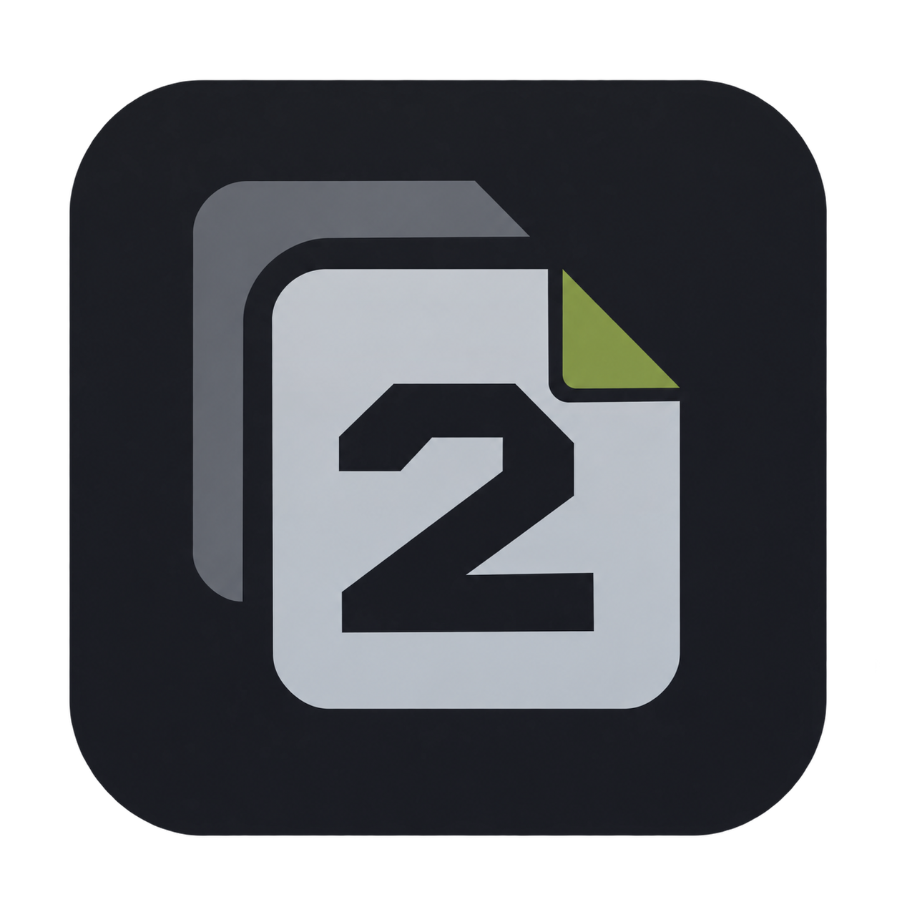
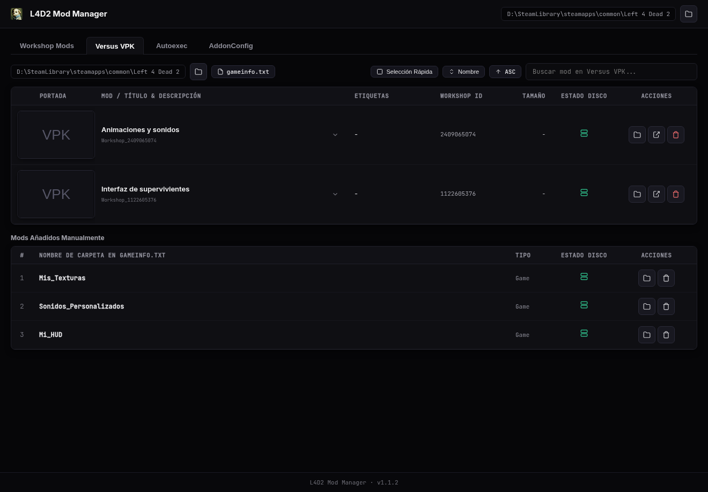
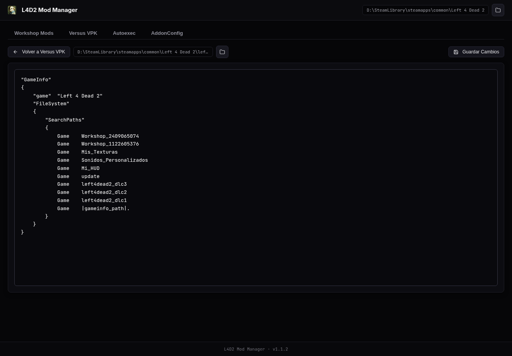
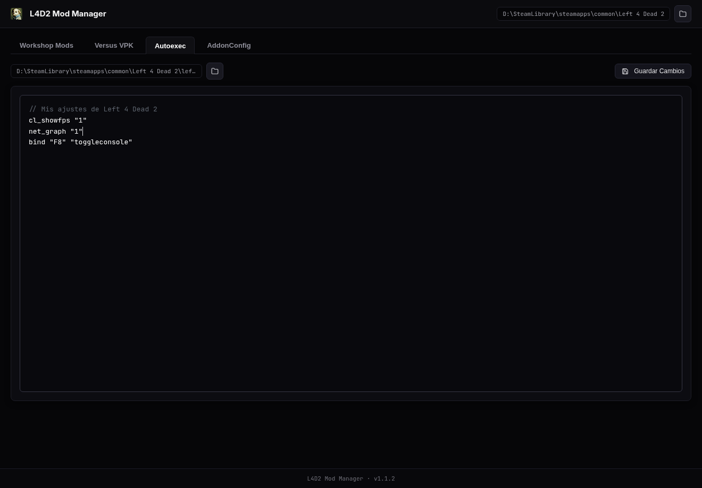
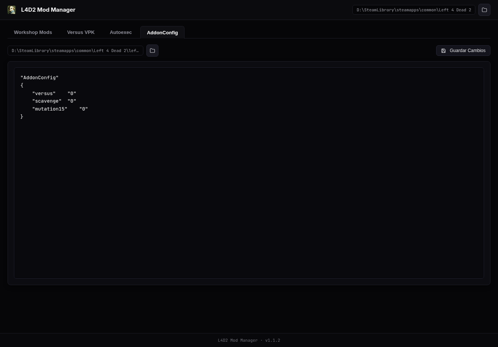

<p align="center">
  
</p>

<h1 align="center">L4D2 Mod Manager</h1>

<p align="center">Administra tus mods y configuraciones de Left 4 Dead 2 desde una aplicación de PC.</p>

<p align="center">
  <a href="https://github.com/CodeByDante/manager-left-4-dead-2/releases/download/v1.1.2/L4D2-Mod-Manager-1.1.2-x64.exe">
    
  </a>
</p>

<p align="center">Windows de 64 bits · Portable · No requiere Node.js para utilizar el ejecutable</p>
<p align="center"><a href="https://github.com/CodeByDante/manager-left-4-dead-2/releases">Ver versiones y archivos en Releases</a></p>

## Tu interfaz original

Se conserva el diseño del proyecto original: fondo oscuro, pestañas superiores **Workshop Mods**, **Versus VPK**, **Autoexec** y **AddonConfig**, portadas grandes, tabla, etiquetas y botones de iconos. El icono oscuro identifica la aplicación en Windows; tu logo original aparece pequeño junto al nombre. Los editores utilizan una selección gris discreta.


> Capturas de la interfaz real ejecutada con datos ilustrativos para documentar su uso. Las rutas y configuraciones visibles son ejemplos. Los mods y sus portadas pertenecen a sus respectivos autores; su aparición aquí no certifica compatibilidad con todos los modos o servidores. El ejecutable solo lista los archivos presentes en la instalación seleccionada.

## Qué hace

La herramienta automatiza tareas de archivos y configuración que normalmente se realizan a mano:

- Detecta Steam y busca L4D2 en sus bibliotecas.
- Lee los VPK locales del Workshop y consulta sus datos en Steam.
- Prepara una copia de los VPK en una carpeta propia y registra esa ruta en `SearchPaths` de `gameinfo.txt`.
- Conserva el VPK original. Comprueba y copia los segmentos cuando el VPK está dividido.
- Muestra las carpetas de mods que moviste y registraste manualmente.
- Permite editar `gameinfo.txt`, `autoexec.cfg` y `addonconfig.cfg`.
- Respalda las configuraciones antes de modificarlas y permite restaurarlas.

El proyecto se ejecuta directamente con Electron. No utiliza servidor local, Express, Vite, React ni un navegador externo.

## 1. Abrir la aplicación y detectar las rutas

Descarga el `.exe` desde el botón de arriba y ábrelo. No necesitas instalar Node.js ni ejecutar comandos para usar el portable.

Steam se busca en el registro de Windows y en sus ubicaciones habituales. El juego se busca en las bibliotecas de `libraryfolders.vdf`. Desde la instalación elegida se calculan automáticamente las rutas de Workshop y las configuraciones.

Si no se detecta el juego, se abre el selector de carpetas. Selecciona la carpeta raíz que contiene `left4dead2\gameinfo.txt`. La elección se guarda para las siguientes sesiones.

Para cambiar de instalación, pulsa **Ctrl+O**. Para actualizar la biblioteca, pulsa **Ctrl+R**. El menú de herramientas se muestra con **Alt**.

## 2. Workshop Mods


| Control | Función |
| --- | --- |
| Buscar mod por título o ID | Filtra los archivos encontrados |
| Nombre / Tamaño / ID | Cambia el criterio de ordenación |
| ASC / DESC | Cambia el sentido del orden |
| Flecha junto al mod | Prepara una copia para registrarla en `gameinfo.txt` |
| Carpeta | Abre la ubicación del VPK en Windows |
| Enlace externo | Abre la página del mod en Steam Workshop |
| Fila del mod | Despliega la descripción, etiquetas y acciones adicionales |
| Selección Rápida | Activa la selección múltiple y el botón de conversión por lotes |

Para preparar un mod, pulsa la **flecha** y confirma. La aplicación crea `Workshop_<ID>`, copia el archivo como `pak01_dir.vpk` y añade la carpeta a `SearchPaths`. Antes de modificar `gameinfo.txt`, crea su respaldo.

Los requisitos se consultan al abrir la confirmación individual. Si Steam no responde, se indica que no pudieron verificarse. Desde la descripción desplegada puedes traducir el texto o activar/desactivar el VPK original.

Preparar un mod no transforma sus scripts ni garantiza compatibilidad con todos los modos o servidores. Las copias preparadas son independientes de las actualizaciones del Workshop.

## 3. Versus VPK y mods personalizados



La tabla superior muestra las carpetas de los mods preparados. Puedes abrir su ubicación, visitar su página de Steam y retirar sus registros.

La tabla inferior **Mods Añadidos Manualmente** conserva el funcionamiento original: muestra las carpetas que el usuario movió y registró por su cuenta en `gameinfo.txt`. No es un importador de mods ni muestra datos de demostración.

| Tipo de carpeta | Qué ocurre al retirar su registro |
| --- | --- |
| Movida manualmente por el usuario | Se quita la entrada de `gameinfo.txt`; se conserva la carpeta |
| Creada por esta versión de la aplicación | Se respalda la configuración y se envía la carpeta a la Papelera de Windows |
| Preparada por una versión antigua, sin identificación de esta versión | Se conserva la carpeta al quitar su registro |

El indicador de disco muestra si se encontró la carpeta. Para editar el archivo completo, pulsa **gameinfo.txt** en la barra de Versus VPK.

## 4. Editar gameinfo.txt



1. Abre **Versus VPK → gameinfo.txt**.
2. Revisa o edita el contenido.
3. Pulsa **Guardar Cambios**.
4. Usa **Volver a Versus VPK** para regresar a las tablas.

La estructura de `SearchPaths` se valida antes de guardar. Si existe una versión anterior, se crea su copia de seguridad. Cierra el juego antes de modificar sus archivos.

## 5. Autoexec



En **Autoexec**, edita tus comandos y ajustes personales y pulsa **Guardar Cambios**. Si `autoexec.cfg` todavía no existe, se crea en la carpeta `left4dead2\cfg` de la instalación seleccionada.

## 6. AddonConfig



En **AddonConfig**, revisa o modifica la configuración de addons que utiliza el juego. Pulsa **Guardar Cambios** para escribir el archivo con respaldo previo de su versión existente.

## Copias de seguridad

Las copias se guardan en los datos de usuario de la aplicación, separadas del código y del ejecutable.

- Pulsa **Alt → Herramientas → Abrir copias de seguridad** para verlas.
- Pulsa **Ctrl+Shift+B**, o **Herramientas → Restaurar una copia**, para seleccionar un archivo `.bak` y confirmar su recuperación.
- Antes de restaurar se respalda también la configuración actual.
- Solo se aceptan copias correspondientes a la instalación seleccionada.

Restaurar `gameinfo.txt` no recupera por sí solo una carpeta retirada: si corresponde, restaura también esa carpeta desde la Papelera de Windows. Cierra el juego y Steam antes de recuperar configuraciones.

## Ejecutar el código fuente

Esta sección es para desarrollar el proyecto. El usuario del `.exe` no necesita estos pasos.

Requiere Windows y Node.js LTS 22 o superior.

```cmd
npm ci
npm start
```

También puedes abrir `abrir_app_escritorio.bat` desde la carpeta del proyecto.

## Construir el portable

```cmd
npm run build
```

El resultado queda en `release\L4D2-Mod-Manager-1.1.2-x64.exe`.

El flujo **Windows desktop** de GitHub Actions instala las dependencias, verifica el código, ejecuta las pruebas y construye el ejecutable en Windows. Las versiones publicadas se encuentran en [Releases](https://github.com/CodeByDante/manager-left-4-dead-2/releases).

## Organización del proyecto

| Ruta | Contenido |
| --- | --- |
| `app/main.cjs` | Ventana de PC, diálogos y menú nativo |
| `app/preload.cjs` | Comunicación limitada entre la interfaz y Electron |
| `app/renderer/index.html` y `styles.css` | Estructura y estilo de la interfaz original |
| `app/renderer/app.js` | Controles originales de pestañas, búsqueda, orden y editores |
| `app/renderer/original-controls.js` | Renderizado seguro de datos y acciones corregidas |
| `app/renderer/bridge.js` | Conexión de los controles originales con las operaciones de escritorio |
| `app/services/` | Archivos del juego, mods, rutas, configuraciones, Steam y copias |
| `app/assets/` | Logo, icono y tipografías locales con sus licencias |
| `docs/images/` | Capturas y botón de descarga del README |
| `tests/` | Pruebas con archivos temporales, sin alterar tu instalación |

Las tipografías se incluyen localmente para conservar el diseño sin descargarlas al iniciar. Workshop y traducción requieren conexión; la gestión de configuraciones utiliza los archivos locales.

## Verificar el proyecto

```cmd
npm run check
npm test
```

Las pruebas comprueban las rutas manuales, la conservación de originales, la preparación de VPK y sus segmentos, la recuperación de configuraciones, el manejo de errores y los límites de los bloques KeyValues de Valve.
